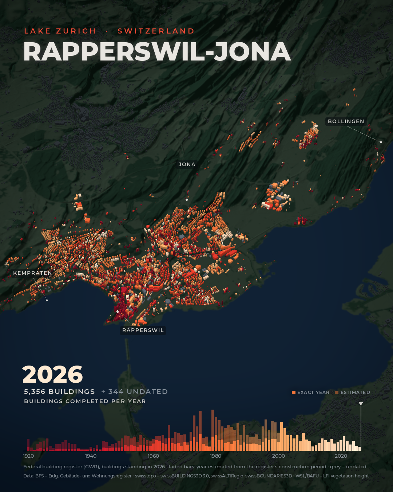

# Rapperswil-Jona — a town built up, building by building

A 32-second vertical animation of how **Rapperswil-Jona** (canton St. Gallen, Switzerland)
was built: the 5,700 buildings standing today, on a 3D landscape between Lake Zurich and
the Obersee, each appearing in its year of construction from the **federal building
register**.



**Video:** [`out/rapperswil_jona_buildings.mp4`](out/rapperswil_jona_buildings.mp4) —
1080 × 1350 px (4:5, Instagram feed), 30 fps, H.264, no sound. Full-screen Reels version:
[`out/rapperswil_jona_buildings_9x16.mp4`](out/rapperswil_jona_buildings_9x16.mp4)
(1080 × 1920), lettering kept clear of the Reels interface. A ready-to-paste caption in
German and English is in [`docs/CAPTION.md`](docs/CAPTION.md).

Inspired by [tulparmaps](https://www.instagram.com/tulparmaps/)' reel "Hong Kong buildings
construction year" and built on the La Paz project
[CarlitoVital/Fable_5.2_Test_10.11.2026](https://github.com/CarlitoVital/Fable_5.2_Test_10.11.2026)
(its renderer is reused). The request that started this, and a better way to phrase it,
are in [`docs/PROMPT.md`](docs/PROMPT.md).

## What the picture says

| | buildings |
|---|---:|
| Standing before 1919 (deep crimson, the opening state) | 680 |
| Built 1919 – 2026, exact year in the register | 2,487 |
| Built 1919 – 2026, year estimated from the register's construction period (faded bars) | 2,189 |
| Undated (grey, revealed at the end) | 344 |
| **Drawn in total** | **5,700** |

In 1918 the town was Rapperswil's medieval old town on its peninsula and the farming
villages around it: 680 of today's buildings. Four in five (78 %) went up after 1945; the
1970s and 1980s alone added 1,524 (28 %), and 943 (18 %) are from after 2000. The camera
starts close on the old town and pulls back as Jona fills the plain behind it.

## Run it

Works on Windows, macOS and Linux with **Python 3.9 – 3.13** and **git**. ffmpeg is
optional (the copy that comes with `imageio-ffmpeg` is used if none is installed). Plan for
about 5 GB of free disk (1 GB of raw data; frames are written to disk before encoding) and
8 GB of RAM for the default four parallel jobs. No GPU, no accounts, no API keys.

**1. Get the code**

```bash
git clone -b claude/zealous-lovelace-alpspn https://github.com/CarlitoVital/Rapperswil_Building.git
```

```bash
cd Rapperswil_Building
```

**2. Create the Python environment** (once) — macOS / Linux:

```bash
python3 -m venv .venv
source .venv/bin/activate
pip install --upgrade pip
pip install -r requirements.txt
```

Windows (PowerShell): `py -3.12 -m venv .venv`, then `.venv\Scripts\Activate.ps1` and the
two `pip` lines. Activate the environment again in every new terminal.

**3. Download and prepare the data** (once: about 350 MB, a few minutes)

```bash
python -m pipeline
```

This fetches, links, dates, builds the 3D scene and prints the checks described under
[Checks](#checks); `python -m pipeline --no-fetch` reprocesses without downloading.

**4. Render**

```bash
python -m render.animate --year 1970
```

writes one still to `out/` to check the look (the first run spends half a minute compiling
the renderer).

```bash
python -m render.animate
```

renders the film (`out/rapperswil_jona_buildings.mp4` and `out/poster.png`) in about five
minutes on four cores (the 9:16 version takes about half as long again). `--format 9x16` makes the Reels version, `--preview` a half-size
draft, `--still 12.5` a single frame at 12.5 s, `--jobs 2` uses less memory.
`python -m pytest` runs the unit tests.

Hosts the pipeline talks to, for sandboxes with an allow-list: `public.madd.bfs.admin.ch`,
`data.geo.admin.ch`, `api3.geo.admin.ch`.

## Data

All open government data from Swiss federal offices, fetched over plain HTTPS.

| Used for | Dataset | Publisher | Edition | Licence |
|---|---|---|---|---|
| Construction year / period, status, EGID | [Federal Register of Buildings and Dwellings (GWR)](https://www.housing-stat.ch/), public extract for canton St. Gallen | Federal Statistical Office (BFS) | export of 24 Nov 2026 | free use, source must be cited |
| Footprints, heights | [swissBUILDINGS3D 3.0](https://www.swisstopo.admin.ch/en/landscape-model-swissbuildings3d-3-0-beta), layer `Floor` (with EGID) | swisstopo | 2025 tiles, 2022 where no newer exists | swisstopo OGD, attribution |
| Terrain | [swissALTIRegio](https://www.swisstopo.admin.ch/en/height-model-swissaltiregio), 10 m | swisstopo | 2026 | swisstopo OGD, attribution |
| Municipal boundary | swissBOUNDARIES3D via api3.geo.admin.ch | swisstopo | 2026 | swisstopo OGD, attribution |
| Forest tint | NFI vegetation height model (Sentinel-2), 10 m | WSL / FOEN (BAFU) | 2025 | OGD, attribution |

The terrain and vegetation rasters are read as windows out of the national
cloud-optimised GeoTIFFs; lakes are found as the large perfectly flat areas of the terrain
model (Lake Zurich lies at 405.91 m).

**How much the register knows** (Rapperswil-Jona, BFS no. 3340):

| | |
|---|---:|
| Standing buildings in the register | 6,566 |
| … with an exact construction year | 3,071 |
| … with only a construction period | 2,930 |
| … with neither | 565 |
| 3D footprints in the municipality | 5,703 |
| … linked to the register by EGID | 5,567 (97.6 %) |
| … linked by location (register point inside the footprint) | 27 |
| … whose register record says *demolished* (dropped) | 47 |
| … not in the register (shown grey) | 62 |
| Recent register buildings not yet in the 3D model, drawn as boxes | 44 |
| Register entries not drawn: garages and underground car parks 367, small structures (carports, sheds) 260, unclassified 248, other 54 | 929 |

## How a building gets its year

In plain words (code: [`pipeline/date_buildings.py`](pipeline/date_buildings.py), all
thresholds in [`pipeline/config.py`](pipeline/config.py)):

1. **Footprint and register record are linked by the EGID**, the federal building
   identifier both carry. Where the 3D model has no EGID, a register point lying inside the
   footprint links them. Footprints whose register record is *demolished* are dropped.
2. **Exact year** (`GBAUJ`, 2,487 buildings): the building appears in that year — in its
   month where the register has one (January is ignored: it is the register's default and
   makes up about 90 % of all recorded months).
3. **Before 1919** (`GBAUJ` before 1919 or period "before 1919", 680): the register lumps
   all older buildings together, so they form the opening stock and rise first, from the
   old town outwards.
4. **Only a construction period** (`GBAUP`, e.g. 1961 – 1970; 2,189): the year is
   *estimated* — the median year of the nearest register buildings of the same period that
   do have an exact year (up to 7 within 150 m, at least 3; 1,425 buildings). Estates and
   streets were mostly built in one go, so neighbours of the same period are good
   witnesses. With too few nearby, the year is drawn — deterministically, from the EGID —
   from the municipality's distribution of exact years in that period (764). Since 2001
   every new building has an exact year, so estimates only occur between 1919 and 2000.
5. **Placeholder years** are not taken at face value: 145 buildings carry exactly 1919, the
   first year of the 1919 – 1945 period, against 12 in 1920 and 2 in 1921 (canton-wide
   1918 – 1920 hold 8,500 buildings against about 100 a year after). A year holding more
   than five times the median of the three years on either side is treated as "period
   known, year unknown" (rule 4). Only 1919 qualifies.
6. **Neither year nor period** (282), or **no register record** (62): grey, revealed at the
   end and counted, never guessed.
7. **The 3D model lags the register.** Of the buildings completed in 2023 only 48 % have a
   footprint yet, of 2024 10 %, of 2025 – 26 none. Register buildings completed since 2019
   that have no footprint are drawn as boxes of the register's floor area (`GAREA`) and
   storey count (`GASTW` × 3 m) — 44 of them; garages, underground car parks and small
   structures (classes 1242, 1274) never become boxes.
8. **One correction by hand:** Schloss Rapperswil has neither year nor period in the
   register; it is put in the "before 1919" stock (built around 1220 – 1230, Historisches
   Lexikon der Schweiz). Only that coarse class is ever assigned by hand, never a year.

**Heights** are swissBUILDINGS3D's total height (ground to the highest point of the roof),
extruded as flat-topped blocks and exaggerated 3×; terrain 1.6×.

## Checks

`python -m pipeline.validate` reruns all of this and writes
[`data/processed/validation.json`](data/processed/validation.json) and
[`out/diagnostic_years.png`](out/diagnostic_years.png), a top-down map of all building
years.

**Is the estimation rule any good?** Tested on the 1,902 buildings of 1919 – 2000 whose
year *is* known: hide the year, keep only the period, estimate, compare.

| Rule | mean error | exact year | within ± 2 years |
|---|---:|---:|---:|
| **In use** (neighbours of the same period, else period distribution) | **2.2 y** | **34 %** | **67 %** |
| … where enough neighbours were found (66 % of cases) | 1.8 y | 44 % | 74 % |
| Middle of the period | 2.5 y | 9 % | 62 % |
| Random year from the period's distribution | 3.3 y | 13 % | 53 % |

The rule beats both baselines overall and in six of eight periods; for 1946 – 1960 and
1986 – 1990 it is level with the middle of the period. The gain is modest in mean error but
large in exact hits, and it keeps estates together on screen instead of scattering them.

**Landmarks** whose age is known independently of the register:

| Building | Result |
|---|---|
| Schloss Rapperswil (13th c.) | before 1919 (by the hand correction above) |
| Stadtpfarrkirche St. Johann, old town | before 1919 |
| Kapuzinerkloster Rapperswil (1606) | before 1919 |
| Kloster Wurmsbach (founded 1259) | before 1919 |
| Hotel Schwanen, old town | before 1919 |
| Hochschule Rapperswil (founded 1972) | 1972 |

**Per period, drawn vs. register:** before 1919 680 / 711 · 1919 – 45 478 / 491 ·
1946 – 60 532 / 557 · 1961 – 70 527 / 600 · 1971 – 80 762 / 858 · 1981 – 85 416 / 463 ·
1986 – 90 343 / 387 · 1991 – 95 257 / 301 · 1996 – 2000 418 / 486 · 2001 – 05 308 / 354 ·
2006 – 10 204 / 245 · 2011 – 15 126 / 159 · 2016 – 26 305 / 389. The gap is the register
entries without a visible footprint (garages, underground car parks, sheds).

## What not to conclude from it

- **Only buildings standing in 2026 are shown.** Demolished buildings are not in the
  film — the register records 487 demolitions in Rapperswil-Jona, with years only from
  1999 — so the early decades look emptier than the town was. A farmhouse replaced by flats
  in 1975 appears in 1975 only.
- **Almost half of the years since 1919 are estimates** (the faded bars). Expect ± 2 years;
  single-year peaks in the chart (1973, 1975, 1979) are largely estimated. Read decades,
  not years.
- **"Before 1919" spans seven centuries**, from the 13th-century castle to houses of 1918.
- **Construction year means completion** as recorded by the municipality. Renovations do
  not change it; a replacement building gets a new record.
- **Undated buildings** are mostly non-residential (261 of the 282 undated register
  buildings: halls, workshops, stores), for which the register has been less complete
  historically; 33 of the 62 footprints without a register record are storage tanks.
- **Neighbouring municipalities** (dark blocks) are backdrop only, not dated.
- **Heights are simplified**: flat blocks at the total height, so pitched roofs look
  bulkier than they are.

## Make it yours

- [`render/config.py`](render/config.py) — title, your name (`AUTHOR`), camera move
  (`CAMERA_START` → `CAMERA_END`), timing, colours, labels, exaggeration, whether to show
  the neighbouring municipalities. Other frame shapes need no layout work (`--format 9x16`).
- [`pipeline/config.py`](pipeline/config.py) — area and rules. **For another Swiss
  municipality** set `BFS_NR`, `CANTON` (two letters, lower case), `ORIGIN` and the two
  LV95 boxes (`CONTEXT_BOX` for buildings and fine terrain, `TERRAIN_BOX` for the
  backdrop), then rerun `python -m pipeline` and adjust the camera and labels. Check the
  coverage table the pipeline prints before rendering.

## Why a software renderer

As in the La Paz project: the scene is about 9.5 million triangles (two terrain meshes and
39,000 buildings). The film is drawn by a small z-buffer rasteriser written in NumPy and
compiled with Numba ([`render/raster.py`](render/raster.py)) — about 1.2 s per frame at 4×
supersampling on one core, identical output on any machine, no system libraries.

## Layout

```
pipeline/   fetch · footprints · date_buildings · build_scene · validate · wkb (TIN reader) · config
render/     raster (rasteriser) · animate (timeline, camera, post, encoding) · overlay (lettering) · config
tests/      unit tests: TIN reading, dating rules, rasteriser, timeline, colour ramp
docs/       PROMPT.md – the original request and a better version of it; CAPTION.md – post text
data/       raw/ processed/ scene/ are created by the pipeline; summary.json and validation.json are committed
out/        the videos (4:5 and 9:16), their poster frames and the diagnostic map
assets/     Montserrat (SIL Open Font License)
```

## Credits

Building register: Bundesamt für Statistik (BFS), Eidg. Gebäude- und Wohnungsregister.
swissBUILDINGS3D 3.0, swissALTIRegio, swissBOUNDARIES3D © swisstopo. Vegetation height
model: Swiss National Forest Inventory (NFI), WSL / FOEN. Typeface: Montserrat, SIL OFL
1.1. Renderer and overlay adapted from
[Fable_5.2_Test_10.11.2026](https://github.com/CarlitoVital/Fable_5.2_Test_10.11.2026).
